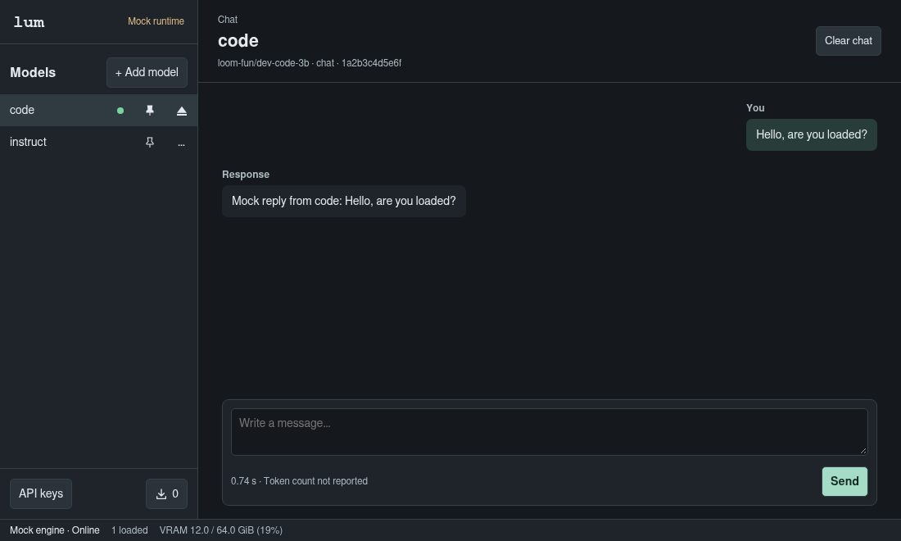

# Lum

Lum is a Rust web manager for local hrx-loom chat models. Use one system service to browse `loom-fun` packages on Hugging Face, download a pinned revision, and run multiple models on one private engine. The library distinguishes installed packages from models ready for requests, and restores started aliases after a restart.



## Open the library

1. Follow the [installation guide](packaging/INSTALL.md) for Fedora 44 (RPM), Debian/Ubuntu (DEB), or a manual installation. Download the tested x86-64 packages, tarball and checksums from [GitHub Releases](https://github.com/dougmaitelli/lum/releases/latest). Starting with v0.1.1, Lum installs a private, pinned Loom SDK on first start. The published v0.1.0 packages predate automatic provisioning; use the [v0.1.0 guide](https://github.com/dougmaitelli/lum/blob/v0.1.0/packaging/INSTALL.md) for those binaries.
2. On the server, open **http://127.0.0.1:9390/**. From a workstation, first run `ssh -N -L 9390:127.0.0.1:9390 user@server`, then open the same URL. The admin listener is loopback-only and trusts local users.
3. Choose a text package in **Catalog**, review its model card, set an alias and preset, and click **Download**. Refresh the library to check progress. Click **Start model** and open the playground once ready.

The playground supports multi-turn chat and shows elapsed time, completion tokens and end-to-end output tokens/s when Loom reports usage. Replies appear after generation finishes. **Metrics** exposes native Prometheus text. Streaming chat, a LAN inference API and GPU memory admission controls are not shipped yet.

## Development

Building Lum on Linux requires Rust and a C compiler (bundled SQLite); it does not require Python, Loom, Node or a GPU. `lum doctor` checks managed-install prerequisites without installing anything (or probes both tools under an explicit `LUM_RUNTIME_BIN` override). Running the managed SDK uses system Python 3.12+ with venv/ensurepip (installed as package dependencies) and internet access on first use.

To preview the UI **without a unit, sudo, uv, or a preinstalled Loom**, run from this checkout:

```sh
cargo run --locked -- run
```

With a binary built from this checkout, the equivalent is `lum run`. Open the printed URL during setup; a failed installation shows a Retry button. The default backend is `amdgpu`; use `LUM_DEVICE=task` for a CPU-only test. No user unit is created and your uv tools are untouched. `LUM_ADMIN_PORT` overrides the default port 9390. Stop with Ctrl-C. See [architecture and acceptance criteria](ARCHITECTURE.md).

Checks: `cargo fmt --check`, `cargo clippy --locked --all-targets -- -D warnings`, `cargo test --locked`. With a native 0.3.0 `loom-serve` on `PATH`, run `cargo test --locked -- --include-ignored` to also exercise the two-model lifecycle and the UI start/chat/restore/stop/remove flow on CPU. The test fixture is not part of the production binary.

To build distribution artifacts on x86-64 Linux, run `cargo build --locked --release && packaging/build.sh` with nFPM 2.49.0 on `PATH`. See `dist/` for the packages and SHA-256 manifest.
